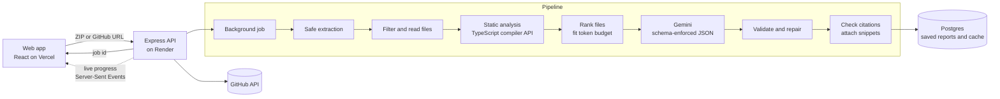

# RepoInsight-AI

> AI engineering reviews for code repositories: architecture, code quality, improvement plan, resume bullets and interview questions, with every claim tied to real lines of code.

[](https://github.com/AtulBoyal/RepoInsight-AI/actions/workflows/ci.yml)

**Live demo:** https://repo-insight-ai-ab.vercel.app

<p align="center">
  
</p>

Paste a public GitHub URL or upload a ZIP. RepoInsight-AI extracts the code safely, runs static analysis, picks the most informative files for the model, and asks Gemini for a structured review. Every file and line the model cites is then checked against the actual code, and the real snippet is shown next to it.

---

## What a report contains

| Section                  | Details                                                                           |
| ------------------------ | --------------------------------------------------------------------------------- |
| Summary and tech stack   | Purpose of the project; languages, frameworks, databases, tools, infrastructure   |
| Architecture             | Strengths, weaknesses, scalability, maintainability                               |
| Scores                   | Folder structure, code quality and resume value, 0 to 10 with a calibrated rubric |
| Strengths and weaknesses | Each with evidence: file, line and the real code snippet                          |
| Improvement plan         | Problem, recommendation, expected impact and priority                             |
| Resume feedback          | Ready-to-use resume bullets                                                       |
| Interview questions      | Based on decisions in this repository, with expected answers                      |

Reports can be downloaded as Markdown or shared with a link.

---

## How it works



1. **Start:** `POST /api/analyze` (ZIP) or `POST /api/analyze/github` returns a job id immediately.
2. **Follow:** the browser subscribes to `GET /api/jobs/:id/events` and receives each stage, then the report.
3. **Reuse:** if the same GitHub commit or the same ZIP was analyzed before, the saved report is returned instantly.

---

## Engineering decisions

### Treat every upload as hostile

**Problem:** a ZIP can contain symlinks to server files, `../` paths, or a few KB that expand to gigabytes. **Built:** a streaming extractor that skips symlinks, rejects unsafe paths, never writes `node_modules` or `.git` to disk, and stops at size and file-count limits. Secret files (`.env`, private keys) are never read, so they never reach the model or the logs. Uploads and extracted files are deleted after every analysis.

### Make the model's claims checkable

**Problem:** LLM reviews cite files and lines that do not exist. **Built:**

- Gemini's structured output, generated from the same Zod schema that validates the response, with one repair attempt if it still fails
- Line numbers in the prompt, so the model cites instead of counting
- A grounding step that drops citations of files the model was not shown, moves off-by-a-few lines onto the code they quote, and attaches the real snippet

**Result:** on the same repository, citations with a valid file and line rose from **5 of 31** before line numbering to **83 of 102** after (3 runs), and citations of files that do not exist are removed before users see them.

### Fit large repositories into one prompt

Files are ranked by importance (README and manifests, entry points, then the most-imported modules from a lightweight import graph) and added until a token budget is reached. The model sees which files were left out, so it does not guess about them.

### Real static analysis instead of regexes

JavaScript and TypeScript are parsed with the TypeScript compiler API: exact function lengths, real `any` and type-assertion nodes (`as const` excluded), console and `process.exit` calls. The same facts feed both the metrics and the evidence locations, so they always agree.

### Long-running work over HTTP

An analysis takes about a minute. Each one runs as a background job with its own progress, logs and result, streamed with Server-Sent Events, so concurrent users never see each other's state and a reconnecting browser gets the current state immediately.

### Control cost on a public demo

- Rate limits per visitor and per day, checked before the upload is received; only new analyses count
- A report cache keyed by GitHub commit SHA or ZIP SHA-256 plus an analysis version (model, prompt and schema fingerprint), so changing the prompt invalidates old reports automatically
- Identical concurrent requests share one job
- A concurrency cap on running analyses

### Sharing without leaking code

Reports can contain snippets of private code, so links are opt-in: a report gets a link only when the user clicks Share. Share ids are 128-bit random, pages are not indexed, only the sharing browser can unshare (its token is stored hashed), and reports are deleted after 30 days.

### Tested where it matters

92 backend tests (Vitest) cover ZIP attacks, secret filtering, citation grounding, the parser, file ranking, rate limits, caching, GitHub handling and sharing. Database tests run on PGlite (Postgres in-process). GitHub Actions runs typecheck, tests, lint, builds and a schema sync check on every push. An evaluation script measures how much scores and citations vary between runs.

---

## Screenshots

| Analyze a GitHub URL or upload a ZIP                                                                        | Live progress                                                                                                  |
| ----------------------------------------------------------------------------------------------------------- | -------------------------------------------------------------------------------------------------------------- |
|  |  |

| Evidence with real code                                                                                                      | Shared report                                                                                     |
| ---------------------------------------------------------------------------------------------------------------------------- | ------------------------------------------------------------------------------------------------- |
|  |  |

---

## Tech stack

| Area           | Technologies                                                        |
| -------------- | ------------------------------------------------------------------- |
| Frontend       | React 19, TypeScript, Vite, Tailwind CSS                            |
| Backend        | Node.js, Express 5, TypeScript, Zod, yauzl, TypeScript compiler API |
| AI             | Google Gemini 2.5 Flash with structured output                      |
| Data           | Postgres (Neon) via `pg`; PGlite in tests                           |
| Testing and CI | Vitest, GitHub Actions                                              |
| Hosting        | Vercel (frontend), Render (backend)                                 |

---

## Project structure

```text
apps/
├── backend/
│   ├── src/
│   │   ├── repository/   extraction, filtering, metrics, static analysis
│   │   ├── ai/           context, prompt, Gemini client, validation, grounding, Markdown
│   │   ├── github/       URL parsing and repository download
│   │   ├── jobs/         background jobs and progress
│   │   ├── cache/        report cache (memory or Postgres)
│   │   ├── sharing/      share links
│   │   ├── db/           Postgres connection and schema
│   │   └── routes/       HTTP endpoints
│   ├── test/             Vitest suites
│   └── scripts/eval.ts   consistency evaluation
└── frontend/
    └── src/              pages, components, API client
scripts/                  report schema sync
```

The report format is defined once, as a Zod schema in `apps/backend/src/ai/report/report.schema.ts`. Each app deploys from its own folder, so the frontend uses a generated copy. After changing the schema, run `npm run sync:schema` from the repository root (`npm run check:schema` fails in CI if the copy is stale).

---

## Running locally

```bash
git clone https://github.com/AtulBoyal/RepoInsight-AI.git
cd RepoInsight-AI
```

**Backend** (http://localhost:5000):

```bash
cd apps/backend
npm ci
cp .env.example .env    # then set GEMINI_API_KEY
npm run dev
```

**Frontend** (http://localhost:5173):

```bash
cd apps/frontend
npm ci
npm run dev
```

The frontend calls `http://localhost:5000/api` by default; set `VITE_API_URL` to change it. Without `DATABASE_URL`, reports are cached in memory and sharing is turned off.

### Tests

```bash
cd apps/backend
npm run typecheck   # source, tests and scripts
npm test
```

### Measuring consistency

```bash
cd apps/backend
npm run eval -- --runs 3 path/to/repo.zip
```

Runs the real pipeline several times (paid Gemini calls) and reports the spread of scores and citation accuracy. Results are saved to `apps/backend/eval-results/`.

---

## Configuration

Backend settings (`apps/backend/.env`). Only `GEMINI_API_KEY` is required.

| Variable                   | Default            | Purpose                                                                             |
| -------------------------- | ------------------ | ----------------------------------------------------------------------------------- |
| `GEMINI_API_KEY`           |                    | Gemini API key (required)                                                           |
| `GEMINI_MODEL`             | `gemini-2.5-flash` | Model used for reviews                                                              |
| `GEMINI_TEMPERATURE`       | model default      | Sampling temperature, 0 to 2                                                        |
| `FRONTEND_URL`             |                    | Deployed frontend origin, allowed by CORS                                           |
| `DATABASE_URL`             |                    | Postgres connection string; enables saved reports and share links                   |
| `REPORT_RETENTION_DAYS`    | `30`               | How long saved reports and links are kept                                           |
| `GITHUB_TOKEN`             |                    | Raises GitHub's API limit from 60 to 5,000 requests per hour; no permissions needed |
| `RATE_LIMIT_PER_HOUR`      | `5`                | New analyses per visitor per hour (0 = no limit)                                    |
| `RATE_LIMIT_PER_DAY`       | `100`              | New analyses for the whole site per day (0 = no limit)                              |
| `MAX_CONCURRENT_JOBS`      | `2`                | Analyses running at once                                                            |
| `MAX_PROMPT_TOKENS`        | `150000`           | Prompt budget; files are ranked and added until reached                             |
| `REPORT_CACHE_MAX_ENTRIES` | `50`               | Reports cached in memory when there is no database (0 = off)                        |
| `REPORT_CACHE_TTL_HOURS`   | `168`              | How long in-memory cached reports are reused                                        |
| `TRUST_PROXY_HOPS`         | `1`                | Reverse proxies in front of the server (Render: 1)                                  |
| `SAVE_DEBUG_ARTIFACTS`     | `false`            | Save prompts and responses (contain source code) to the log folder                  |

---

## API

| Method   | Path                           | Description                                                                            |
| -------- | ------------------------------ | -------------------------------------------------------------------------------------- |
| `POST`   | `/api/analyze`                 | Upload a ZIP (`repository` form field; optional `force=true` to skip the cache)        |
| `POST`   | `/api/analyze/github`          | `{ "url": "https://github.com/owner/repo", "force"?: true }`; public repositories only |
| `GET`    | `/api/jobs/:id/events`         | Server-Sent Events: `progress`, then `completed` or `failed`                           |
| `GET`    | `/api/jobs/:id`                | Current job state                                                                      |
| `POST`   | `/api/reports/:reportId/share` | Create a share link; returns `{ shareId, expiresAt, ownerToken }`                      |
| `GET`    | `/api/shared/:shareId`         | A shared report                                                                        |
| `DELETE` | `/api/shared/:shareId`         | Remove a link (`Authorization: Bearer <ownerToken>`)                                   |
| `GET`    | `/api/health`                  | Health check                                                                           |

The analyze endpoints answer `202` for a new analysis, `200 { cached: true }` for a saved report, and `200 { joined: true }` when the same input is already being analyzed. Errors are JSON with an `error` code and a readable `message`.

---

## Roadmap

- Parser-based analysis for Python (tree-sitter)
- Security findings: committed secrets (gitleaks) and vulnerable dependencies (osv-scanner)
- Frontend component tests
- Faster first request after the free-tier server sleeps
- Accounts with analysis history
- Repository comparison
- Support for other LLM providers
